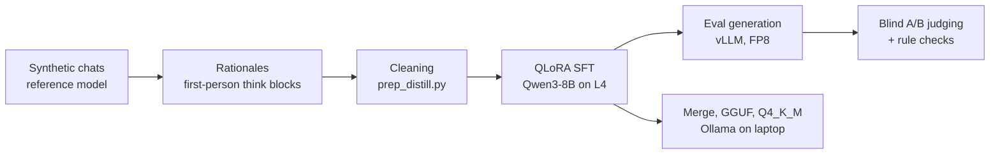

# Archon

**Distilling a "theorycrafting sparring partner" into Qwen3-8B with QLoRA, then judging it honestly.**

> This is a cleaned public snapshot of a private working repo. Development history, datasets and
> model weights are not included.

Archon is a personal, non-commercial learning project. The goal was a small local model that
cross-checks system design, ML and engineering plans: it pushes back when something is wrong,
sanity-checks the numbers and ends with a clear recommendation, in short conversational replies.
I took it end to end on a small budget: synthetic data, QLoRA training on one cloud GPU, a blind
evaluation against the base model, and a quantized build that runs locally in Ollama.

**The headline result is negative, and that is the interesting part.** The fine-tune learned the
target style almost perfectly but made more factual and arithmetic mistakes than the base model,
so base Qwen3-8B won the blind comparison in both training runs. Standard benchmarks agree: same
knowledge as the base model, but 7 points lower on GSM8K and 8 lower on IFEval. The write-up below
explains why. The project is finished; there is no run 3.

## At a glance

| | |
|---|---|
| **Student model** | Qwen3-8B, QLoRA rank 32 (Unsloth + PEFT), 4-bit base |
| **Data** | ~3,950 synthetic multi-turn chats from a strong reference model (3,758 train / 203 eval) |
| **Compute** | One NVIDIA L4 (24 GB) on GCP, about 6.3 hours for 2 epochs |
| **Eval** | Blind pairwise A/B against base Qwen3-8B on held-out chats, plus rule checks |
| **Deployment** | Adapter merged shard by shard on CPU, GGUF + Q4_K_M via llama.cpp, served in Ollama at about 42 tok/s in ~6 GB of VRAM |
| **Outcome** | Style transferred, substance did not. Base model won both runs. |
| **Benchmarks** | Same MMLU/ARC as base, 7 points lower on GSM8K, 8 lower on IFEval, about 2x faster |

## Pipeline



## Results

| Run | What changed | Fine-tune wins | Base wins | Ties |
|---|---|---|---|---|
| Run 1 | Answers only, no thinking | 44 | 113 | 0 |
| Run 2 | Added `<think>` rationales, stricter cleaning | 38 | 125 | 23 |

Run 1 was judged on 157 held-out chats and run 2 on 186. Run 2 did not improve on run 1.

The fine-tune matched the reference shape on every rule check: no markdown headers, almost never
over 250 words, a "My pick:" verdict and a follow-up question, and thinking under 710 tokens
(base used up to 2,652). But in run 2 it was tagged for wrong facts 151 times against 90 for base,
wrong arithmetic 69 against 31, and incoherent reasoning 67 against 9. It also invents specific
flags, APIs and hardware specs. Base loses points for generic checklists, headers and agreeing too
easily, but it is wrong less often.

- Full write-up: [`results/run2/judge/summary.md`](results/run2/judge/summary.md)
- Example answers side by side: [`results/run2/examples.md`](results/run2/examples.md)
- Training loss: eval loss went from **1.64 to 1.51** ([`results/run2/log_history.json`](results/run2/log_history.json))

### Standard benchmarks

Full test sets with lm-evaluation-harness and vLLM on one L4, identical prompts for both models.
Run 2's adapter was merged into the bf16 base weights. GSM8K and IFEval ran with thinking on and
are graded only on the text after `</think>`; MMLU and ARC are scored by answer likelihood.

| Benchmark | Base Qwen3-8B | Archon (run 2) |
|---|---|---|
| MMLU, 14,042 questions, 5-shot | 73.0 | 73.0 |
| ARC-Challenge, 1,172 questions (acc_norm) | 56.7 | 56.9 |
| GSM8K, 1,319 questions, 5-shot | 88.7 | 81.7 |
| IFEval, 541 prompts (prompt-level strict) | 85.2 | 76.9 |


The fine-tune kept the base model's knowledge but thinks about a third as much, and loses about
7 points on math and 8 on following format instructions. It is faster for the same reason.


### Putting it together

| Signal | Base Qwen3-8B | Archon (run 2) |
|---|---|---|
| Blind A/B on 186 held-out chats | 125 wins | 38 wins (23 ties) |
| Matches the target reply style | No | Yes, on every rule check |
| MMLU / ARC (knowledge) | 73.0 / 56.7 | 73.0 / 56.9 |
| GSM8K (math) | 88.7 | 81.7 |
| IFEval (instructions) | 85.2 | 76.9 |
| IFEval prompts with a word-count rule passed | 38 of 50 | 18 of 50 |
| Tokens per GSM8K answer, thinking included | 896 | 281 |

Both evaluations point the same way. Fine-tuning did not damage what the model knows, but it
taught it to reason briefly and answer in one fixed shape. That shows up as arithmetic slips,
misread questions and ignored format rules, which is exactly what the blind judge tagged. Archon
does fix some of base's mistakes too (64 GSM8K questions it gets right and base does not, against
157 the other way), and part of the GSM8K gap is formatting: 53 of Archon's misses and 89 of
base's had the right number in a form the grader did not accept, such as `$7.00`.

### Side by side

Final answers from the benchmark runs, thinking omitted, trimmed for length.

**GSM8K: "Emily can peel 6 shrimp a minute and saute 30 shrimp in 10 minutes. How long will it
take her to peel and cook 90 shrimp?"** (correct: 45)

> **Base:** Peeling 90 shrimp takes 90 / 6 = 15 minutes. Cooking 90 shrimp at 3 per minute takes
> 30 minutes. Total time is 15 + 30 = 45 minutes. **45**
>
> **Archon:** Combined rate: 6 + 3 = 9 shrimp per minute. Total time: 90 / 9 = 10 minutes. **10**

Archon treats two steps done one after the other as if they ran at the same time.

**GSM8K: "A plane travels 1200 miles in 3 hours. At the same rate, how many additional hours would
it take to travel an additional 2000 miles?"** (correct: 5)

> **Base:** Speed is 400 miles per hour, so 2000 more miles takes 5 hours. **5**
>
> **Archon:** 2000 / 400 = 5 hours. Since the plane already traveled 3 hours, the additional time
> needed is 5 - 3 = 2 hours. **2**

The arithmetic is right; the reading of the question is not.

**IFEval: "Write a blog post with 400 or more words about the benefits of sleeping in a hammock."**

> **Base:** 584 words, passes.
>
> **Archon:** 333 words, fails. Training replies were almost all 170 to 200 words, and Archon
> stays near that length even when the prompt asks for more.

**IFEval: "Can you write a rap that doesn't include the keywords 'Yo', 'check', and 'peace'?"**

> **Base:** A two-verse rap without the three words, passes.
>
> **Archon:** "No 'Yo', no 'check', no 'peace', just my style." Fails by quoting the banned words.

## What I learned

- **SFT on another model's text copies the format, not the reasoning.** A lower eval loss and a
  perfect style match did not mean better answers. The model learned to sound confident in the
  right shape, including when it was wrong.
- **Evaluate blind, and check the judge.** Pairs were shuffled with sides randomized and the key
  kept aside until every verdict was in. A 30-pair re-judge with sides swapped found no position
  flips.
- **Data cleaning has to respect conversation structure.** Later turns build on earlier replies,
  so a chat is cut at its first bad reply rather than dropping single turns.
- **Getting a fine-tune onto consumer hardware is its own project.** Ollama would not load the
  LoRA directly, so I merged it shard by shard on the CPU to stay within RAM, then converted and
  quantized it with llama.cpp.
- **Uniform training data makes a rigid model.** Almost every training reply was 170 to 200
  words with the same structure, so Archon answers in that shape whatever the prompt asks. It
  passed 18 of 50 IFEval word-count rules against 38 for base, and a system prompt asking for
  shorter or longer replies barely moves it.
- **Short reasoning in the data means short reasoning in the model.** The rationales were written
  after the fact to justify a known answer, so they are brief. Archon learned to think for about
  280 tokens where base thinks for about 900, and its math suffers for it.
- **Benchmarks and a judge answer different questions.** MMLU and ARC showed no damage at all,
  which on its own would have looked like a clean fine-tune. The judge and GSM8K/IFEval are what
  exposed the cost. Run both.
- **vLLM's runtime LoRA path crashed on this adapter.** Serving base + LoRA in vLLM 0.32 hit a
  CUDA "illegal memory access" partway through, with and without CUDA graphs. Merging the adapter
  into the bf16 weights first (same math, no LoRA kernels) ran cleanly and faster.
- **Plan long GPU runs to survive a crash.** lm-eval's `--use_cache` only saves finished batches,
  and with `--batch_size auto` the vLLM backend treats the whole benchmark as one batch. A fixed
  batch size makes the cache useful.

## Project status

Concluded. Archon reached its style goal and taught me where SFT distillation stops working, which
was the point of the exercise. If I did it again I would:

- Vary reply length and format on purpose in the training data, including replies that follow
  explicit format instructions.
- Keep the reference model's own reasoning instead of writing rationales afterwards, or use
  on-policy distillation, where the student generates and a stronger model scores or corrects it.
- Run GSM8K and IFEval on a small slice after the first epoch, before paying for the full run.

## How it works

**Data.** About 3,950 synthetic multi-turn chats in which a strong reference model plays the
partner: it reviews a user's plan, checks the numbers and gives a verdict. For run 2, each
reference answer was given a first-person rationale written by a Qwen 32B model, explaining how
one would arrive at that answer. The rationale becomes the `<think>` block, so the student learns
to reason before it answers:

```
<think>
{rationale}
</think>

{answer}
```

**Cleaning.** [`train/prep_distill.py`](train/prep_distill.py) cuts each chat before the first
reply whose rationale rejects it, flags a flaw in the answer, is cut off or near-empty, or
contains stray tags or CJK text. Everything after a bad reply is dropped too. That left
**3,366 training chats** (9,134 assistant turns) and 186 held-out eval chats.

**Training.** [`train/sft.py`](train/sft.py) runs QLoRA rank 32 on
`unsloth/Qwen3-8B-unsloth-bnb-4bit` with thinking on. Each assistant turn is its own sample, with
loss on that reply only, because Qwen3's template keeps the think block only on the latest reply.
[`train/check_data.py`](train/check_data.py) verifies the template and loss masking with the real
tokenizer before training starts.

**Eval generation.** [`train/gen_vllm.py`](train/gen_vllm.py) uses vLLM with FP8 weights and
continuous batching. Base and fine-tune get the same prompts: one held-out assistant turn per eval
chat, picked with a fixed seed, with Qwen3's thinking-mode sampling.

**Judging.** [`eval/`](eval) builds blinded A/B packets, runs rule checks on both outputs and the
reference, and then unblinds.

## Data format

Training and eval files are chat JSONL, one chat per line. Every assistant reply is one `<think>`
block followed by the answer. This row is made up to show the shape; it is not from the dataset.

```json
{"messages": [
  {"role": "system", "content": "You are a sharp theorycrafting partner for system design, ML and engineering plans. Cross-check ideas, push back when something is wrong, sanity-check the numbers, and end with a clear recommendation. Keep replies short and conversational. No code unless asked."},
  {"role": "user", "content": "I want to log every API request to Postgres: about 2,000 requests/s at 1 KB each. One table, one index on timestamp. Fine?"},
  {"role": "assistant", "content": "<think>\nFirst check the volume: 2,000 x 1 KB is 2 MB/s, about 170 GB a day. Postgres can take the write rate, but the table grows fast and deleting old rows will hurt. Partitioning by day makes retention a cheap DROP. So the plan works with one change.\n</think>\n\nMostly yes, but that's about 170 GB a day, and deleting old rows from one big table will crawl. Partition by day so retention is a DROP TABLE instead of a DELETE.\n\nMy pick: daily partitions from day one. How long do you need to keep the logs?"}
]}
```

## Repository layout

| Path | What |
|---|---|
| `train/prep_distill.py` | Clean rationale data into `data/distill/{train,eval}.jsonl` |
| `train/sft.py` | QLoRA fine-tune (Unsloth + transformers Trainer) |
| `train/check_data.py` | Pre-flight check of chat template and loss masking |
| `train/gen_vllm.py` | Eval generation with vLLM (FP8) |
| `train/gen_eval.py` | Eval generation with Unsloth/transformers (slower fallback) |
| `eval/packets.py`, `eval/rules.py`, `eval/unblind.py` | Blinded pairwise judging and rule checks |
| `ollama/` | Shard-by-shard LoRA merge script and the Modelfile for Ollama |
| `results/run2/` | Loss history, adapter config, judge summary, example answers |
| `results/run2/bench/` | Benchmark charts |

## Reproducing

You need your own chat data in the format above; the dataset is not published. Training and eval
generation need a CUDA GPU (an L4 with 24 GB was enough). On the GPU machine:

```
pip install unsloth vllm
python train/check_data.py          # run from a folder with data/train.jsonl and data/eval.jsonl
python train/sft.py --data data --out out
python train/gen_vllm.py --out out/gen_base.jsonl --max-new 4096
python train/gen_vllm.py --adapter out/adapter --out out/gen_ft.jsonl --max-new 2048
```

For judging, copy `gen_base.jsonl` and `gen_ft.jsonl` into `results/run2/`, then run
`python eval/rules.py` and `python eval/packets.py`, judge the packets, and run
`python eval/unblind.py`.

### Training config

| Setting | Value |
|---|---|
| Base | `unsloth/Qwen3-8B-unsloth-bnb-4bit` (QLoRA, 4-bit) |
| LoRA | rank 32, alpha 32, dropout 0, all attention and MLP projections |
| Schedule | 2 epochs, lr 1e-4 cosine, 15 warmup steps, no weight decay |
| Batch | 2 per device x 8 gradient accumulation = 16 |
| Max length | 4,096 tokens, loss on the latest assistant reply only, thinking on |

### Benchmarks

Merge the adapter into the bf16 base first (vLLM's LoRA path crashed for me), then run
lm-evaluation-harness 0.4.13 with vLLM on both models with identical settings:

```
pip install vllm "lm_eval[vllm,ifeval]"
python ollama/merge_lora.py <Qwen3-8B-bf16-dir> out/adapter merged

M=Qwen/Qwen3-8B   # then again with M=merged
ARGS="pretrained=$M,dtype=bfloat16,gpu_memory_utilization=0.94,max_model_len=10240,seed=1234"

# knowledge: scored by answer likelihood, no thinking
lm_eval --model vllm --model_args "$ARGS" --tasks mmlu,arc_challenge --batch_size 8192 --use_cache cache/ll

# math and instructions: thinking on, graded after </think>
lm_eval --model vllm \
  --model_args "$ARGS,kv_cache_dtype=fp8,enable_thinking=True,think_end_token=</think>" \
  --tasks gsm8k,ifeval --apply_chat_template --fewshot_as_multiturn \
  --gen_kwargs "temperature=0.6,top_p=0.95,top_k=20,do_sample=True,max_gen_toks=8192" \
  --batch_size 256 --use_cache cache/gen --log_samples --output_path results
```

FP8 applies only to the KV cache; weights stay bf16. On one L4 the full set took about 3 hours
for base and 1.5 hours for Archon.

### Running locally in Ollama

The trained adapter is not published. To run your own adapter, merge it into the base model
first, since Ollama does not load the LoRA directly:

```
python ollama/merge_lora.py <Qwen3-8B-bf16-dir> out/adapter merged
python llama.cpp/convert_hf_to_gguf.py merged --outfile archon-think-f16.gguf
llama.cpp/llama-quantize archon-think-f16.gguf archon-think-q4_k_m.gguf Q4_K_M
ollama create archon:think -f ollama/Modelfile
ollama run archon:think
```

The Modelfile sets the training system prompt, a ChatML template that keeps the think block only
on the latest reply, and Qwen3's thinking-mode sampling. The Q4_K_M model runs fully on an 8 GB
laptop GPU.

## License

Code is Apache-2.0, see [LICENSE](LICENSE). No model weights or training data are distributed.
