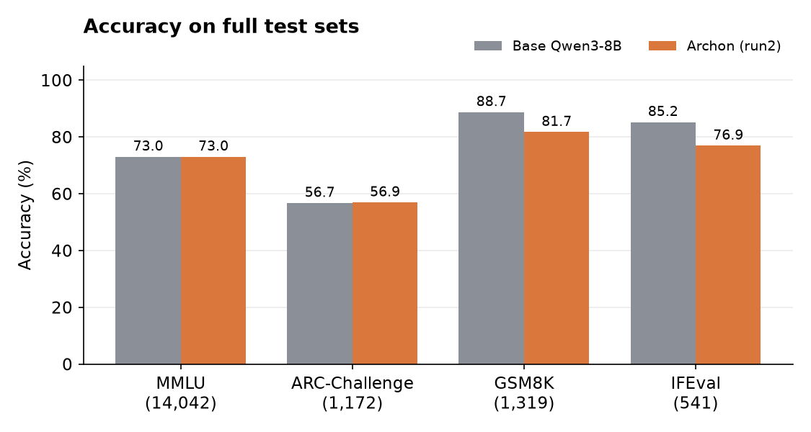
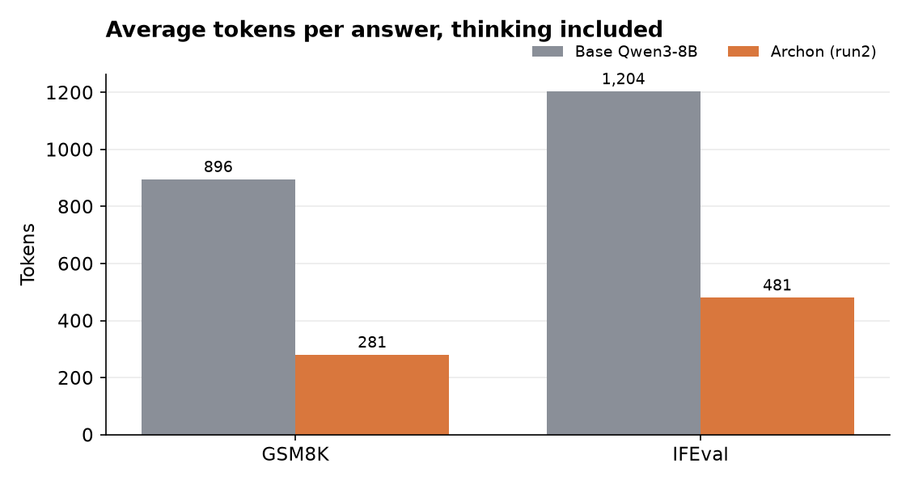
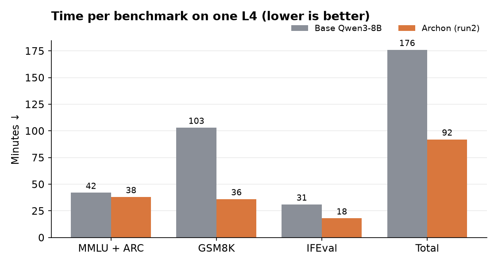
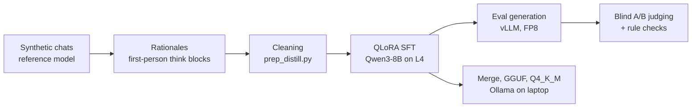

# Archon

[](LICENSE)


Distilling a "theorycrafting sparring partner" into Qwen3-8B with QLoRA, then evaluating it
honestly against the base model.

Archon is a fine-tune meant to review system design, ML and engineering plans: push back when
something is wrong, sanity-check the numbers, and end with a clear recommendation in a short,
conversational reply. The repo covers the full pipeline: data cleaning, QLoRA training with
thinking traces, blind pairwise evaluation, standard benchmarks, and a quantized build for Ollama.

> **Status:** concluded. The fine-tune learned the target style but lost accuracy against base
> Qwen3-8B, in both the blind comparison and on standard benchmarks. Results and lessons are below.
> This is a cleaned public snapshot of a private repo; model weights and training data are not
> included.

## Contents

- [Results](#results)
- [Examples](#examples)
- [Key findings](#key-findings)
- [Getting started](#getting-started)
- [Usage](#usage)
- [How it works](#how-it-works)
- [Project structure](#project-structure)
- [License](#license)

## Results

### Blind pairwise evaluation

Held-out chats, outputs shuffled and sides randomized before judging.

| Run | Change | Archon wins | Base wins | Ties |
|---|---|---|---|---|
| Run 1 (157 chats) | Answers only, no thinking | 44 | 113 | 0 |
| Run 2 (186 chats) | Added `<think>` rationales, stricter cleaning | 38 | 125 | 23 |

Archon matched the target style on every rule check (no headers, under 250 words, a "My pick:"
verdict, a follow-up question). It was also tagged far more often for wrong facts (151 vs 90),
wrong arithmetic (69 vs 31) and incoherent reasoning (67 vs 9). Full write-up in
[`results/run2/judge/summary.md`](results/run2/judge/summary.md).

### Standard benchmarks

Full test sets, [lm-evaluation-harness](https://github.com/EleutherAI/lm-evaluation-harness) 0.4.13
with vLLM on one NVIDIA L4, identical prompts and settings for both models.

| Benchmark | Base Qwen3-8B | Archon (run 2) | Δ |
|---|---|---|---|
| MMLU (14,042, 5-shot) | 73.0 | 73.0 | 0.0 |
| ARC-Challenge (1,172, acc_norm) | 56.7 | 56.9 | +0.2 |
| GSM8K (1,319, 5-shot, flexible) | 88.7 | 81.7 | −7.0 |
| IFEval (541, prompt-level strict) | 85.2 | 76.9 | −8.3 |



| Efficiency | Base Qwen3-8B | Archon (run 2) |
|---|---|---|
| Tokens per GSM8K answer (incl. thinking) | 896 | 281 |
| Tokens per IFEval answer (incl. thinking) | 1,204 | 481 |
| Wall time, all four benchmarks | 176 min | 92 min |

<p>
  
  
</p>

GSM8K and IFEval run with thinking enabled and are graded on the text after `</think>`. MMLU and
ARC are scored by answer log-likelihood.

## Examples

Final answers quoted from the logged benchmark run, thinking omitted.

**GSM8K:** *Emily can peel 6 shrimp a minute and saute 30 shrimp in 10 minutes. How long will it
take her to peel and cook 90 shrimp?* (answer: 45)

| Base ✅ | Archon ❌ |
|---|---|
| Peeling takes 90 / 6 = 15 min. Cooking at 3 per minute takes 30 min. Total 15 + 30 = **45**. | Combined rate 6 + 3 = 9 shrimp per minute, so 90 / 9 = **10** minutes. |

Answers are sampled, so reruns differ; in a later run Archon reached 45 and then picked 30.

**GSM8K:** *A plane travels 1200 miles in 3 hours. At the same rate, how many additional hours would
it take to travel an additional 2000 miles?* (answer: 5)

| Base ✅ | Archon ❌ |
|---|---|
| 400 miles per hour, so 2000 more miles takes **5** hours. | 2000 / 400 = 5 hours, minus the 3 already flown = **2** hours. |

**IFEval:** *Write a blog post with 400 or more words about the benefits of sleeping in a hammock.*

| Base ✅ | Archon ❌ |
|---|---|
| 584 words | 333 words |

**IFEval:** *Can you write a rap that doesn't include the keywords "Yo", "check", and "peace"?*

| Base ✅ | Archon ❌ |
|---|---|
| Two verses, none of the words | *"No 'Yo', no 'check', no 'peace', just my style."* |

More side-by-side chats: [`results/run2/examples.md`](results/run2/examples.md).

## Key findings

- **Style transfers, reasoning doesn't.** SFT on a reference model's answers reproduced the format
  exactly, and eval loss improved (1.64 → 1.51), but answers got less accurate.
- **Knowledge was preserved.** MMLU and ARC are unchanged. Benchmarks that test reasoning and
  instruction following (GSM8K, IFEval) and the blind judge are what exposed the regression.
- **Short rationales produce short reasoning.** The `<think>` rationales were written after the fact
  to justify existing answers. Archon thinks ~3x less than base, which makes it ~2x faster and
  less accurate on math.
- **Uniform data produces a rigid model.** Nearly all training replies were 170–200 words. Archon
  passed 18 of 50 IFEval word-count constraints vs 38 for base, and system prompts barely change
  its length.
- **vLLM 0.32 runtime LoRA crashed** with a CUDA illegal memory access on this adapter, with and
  without CUDA graphs. Merging the adapter into the bf16 weights fixed it.

If I revisited this: vary reply length and format in the training data, keep the reference
model's own reasoning (or use on-policy distillation), and run a small GSM8K/IFEval slice after
the first epoch.

## Getting started

### Requirements

- Python 3.12
- A CUDA GPU with 24 GB for training and evaluation (tested on an NVIDIA L4)
- Your own chat data in the [format below](#data-format); the dataset is not published

### Installation

```bash
git clone https://github.com/aniyow07/Archonn.git
cd Archonn
pip install unsloth vllm "lm_eval[vllm,ifeval]"
```

## Usage

### Train

```bash
python train/check_data.py                 # verify chat template and loss masking
python train/sft.py --data data --out out  # QLoRA fine-tune, writes out/adapter
```

### Generate eval outputs and judge

```bash
python train/gen_vllm.py --out out/gen_base.jsonl --max-new 4096
python train/gen_vllm.py --adapter out/adapter --out out/gen_ft.jsonl --max-new 2048
```

Copy both files into `results/run2/`, then run `python eval/rules.py` and `python eval/packets.py`,
judge the packets, and run `python eval/unblind.py`.

### Run benchmarks

Merge the adapter first, then run both models with identical settings:

```bash
python ollama/merge_lora.py <Qwen3-8B-bf16-dir> out/adapter merged

M=Qwen/Qwen3-8B   # then repeat with M=merged
ARGS="pretrained=$M,dtype=bfloat16,gpu_memory_utilization=0.94,max_model_len=10240,seed=1234"

lm_eval --model vllm --model_args "$ARGS" \
  --tasks mmlu,arc_challenge --batch_size 8192 --use_cache cache/ll

lm_eval --model vllm \
  --model_args "$ARGS,kv_cache_dtype=fp8,enable_thinking=True,think_end_token=</think>" \
  --tasks gsm8k,ifeval --apply_chat_template --fewshot_as_multiturn \
  --gen_kwargs "temperature=0.6,top_p=0.95,top_k=20,do_sample=True,max_gen_toks=8192" \
  --batch_size 256 --use_cache cache/gen --log_samples --output_path results
```

FP8 applies to the KV cache only; weights stay bf16. Use a fixed `--batch_size`: with `auto`, the
vLLM backend treats the whole task as one batch and `--use_cache` saves nothing until the end.

### Run locally with Ollama

```bash
python ollama/merge_lora.py <Qwen3-8B-bf16-dir> out/adapter merged
python llama.cpp/convert_hf_to_gguf.py merged --outfile archon-think-f16.gguf
llama.cpp/llama-quantize archon-think-f16.gguf archon-think-q4_k_m.gguf Q4_K_M
ollama create archon:think -f ollama/Modelfile
ollama run archon:think
```

The Q4_K_M build runs fully on an 8 GB laptop GPU at about 42 tok/s.

## How it works



1. **Data.** ~3,950 synthetic multi-turn chats where a strong reference model plays the partner.
   For run 2, a Qwen 32B model wrote a first-person rationale for each answer, used as the
   `<think>` block.
2. **Cleaning.** [`train/prep_distill.py`](train/prep_distill.py) cuts each chat at the first
   rejected, flawed, truncated or malformed reply. Result: 3,366 training chats (9,134 assistant
   turns) and 186 eval chats.
3. **Training.** [`train/sft.py`](train/sft.py) trains each assistant turn as its own sample with
   loss on that reply only, since Qwen3's template keeps the think block only on the latest reply.
4. **Evaluation.** [`train/gen_vllm.py`](train/gen_vllm.py) generates both models' answers on the
   same prompts; [`eval/`](eval) builds blinded A/B packets, runs rule checks and unblinds.

### Training configuration

| Setting | Value |
|---|---|
| Base model | `unsloth/Qwen3-8B-unsloth-bnb-4bit` |
| LoRA | r = 32, alpha = 32, dropout 0, all attention and MLP projections |
| Optimization | 2 epochs, lr 1e-4, cosine, 15 warmup steps, no weight decay |
| Effective batch | 16 (2 × 8 gradient accumulation) |
| Max sequence length | 4,096 |
| Hardware | 1× NVIDIA L4 24 GB, ~6.3 hours |

### Data format

Chat JSONL, one chat per line; each assistant reply is a `<think>` block followed by the answer.
Illustrative row (not from the dataset):

```json
{"messages": [
  {"role": "system", "content": "You are a sharp theorycrafting partner for system design, ML and engineering plans. Cross-check ideas, push back when something is wrong, sanity-check the numbers, and end with a clear recommendation. Keep replies short and conversational. No code unless asked."},
  {"role": "user", "content": "I want to log every API request to Postgres: about 2,000 requests/s at 1 KB each. One table, one index on timestamp. Fine?"},
  {"role": "assistant", "content": "<think>\nFirst check the volume: 2,000 x 1 KB is 2 MB/s, about 170 GB a day. Postgres can take the write rate, but the table grows fast and deleting old rows will hurt. Partitioning by day makes retention a cheap DROP. So the plan works with one change.\n</think>\n\nMostly yes, but that's about 170 GB a day, and deleting old rows from one big table will crawl. Partition by day so retention is a DROP TABLE instead of a DELETE.\n\nMy pick: daily partitions from day one. How long do you need to keep the logs?"}
]}
```

## Project structure

```
.
├── train/
│   ├── prep_distill.py   # clean rationale data into train/eval JSONL
│   ├── check_data.py     # pre-flight check of chat template and loss masking
│   ├── sft.py            # QLoRA fine-tune (Unsloth + transformers)
│   ├── gen_vllm.py       # eval generation with vLLM
│   └── gen_eval.py       # slower fallback with transformers
├── eval/
│   ├── packets.py        # build blinded A/B packets
│   ├── rules.py          # style rule checks
│   └── unblind.py        # unblind and tally verdicts
├── ollama/
│   ├── merge_lora.py     # shard-by-shard LoRA merge on CPU
│   └── Modelfile
└── results/run2/         # loss history, adapter config, judge summary, examples, charts
```

## License

Code is released under the [Apache 2.0 License](LICENSE). No model weights or training data are
distributed.

## Acknowledgements

Built on [Qwen3](https://github.com/QwenLM/Qwen3), [Unsloth](https://github.com/unslothai/unsloth),
[PEFT](https://github.com/huggingface/peft), [vLLM](https://github.com/vllm-project/vllm),
[lm-evaluation-harness](https://github.com/EleutherAI/lm-evaluation-harness),
[llama.cpp](https://github.com/ggml-org/llama.cpp) and [Ollama](https://ollama.com).
