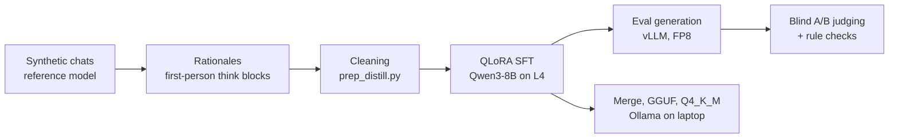

# Archon

A QLoRA fine-tune of Qwen3-8B that I trained to be a sparring partner for system design and ML
plans: it should push back on bad ideas, check the numbers, and end with a clear pick, in a short
chatty reply. Personal, non-commercial project, done on one rented L4 and a laptop.

It didn't work out the way I hoped. The fine-tune picked up the style almost perfectly, but it got
worse at being right. Base Qwen3-8B beat it in a blind comparison in both training runs, and on
standard benchmarks it matches base on knowledge but drops 7 points on GSM8K and 8 on IFEval. I've
stopped the project here.

This repo is a cleaned copy of my private working repo. No weights, no training data, no history.

## Setup in short

- Qwen3-8B, QLoRA rank 32 on the 4-bit Unsloth build, 2 epochs, about 6.3 hours on an L4
- About 3,950 synthetic multi-turn chats from a stronger reference model (3,758 train, 203 eval)
- Blind A/B judging against base on held-out chats, plus rule checks, plus four standard benchmarks
- Adapter merged into the base weights, quantized to Q4_K_M, runs in Ollama on an 8 GB laptop GPU
  at about 42 tok/s



## Results

### Blind comparison

| Run | What changed | Fine-tune wins | Base wins | Ties |
|---|---|---|---|---|
| Run 1 | Answers only, no thinking | 44 | 113 | 0 |
| Run 2 | Added `<think>` rationales, stricter cleaning | 38 | 125 | 23 |

157 held-out chats for run 1, 186 for run 2. Adding thinking didn't help.

Style-wise run 2 did everything I asked: no markdown headers, almost never over 250 words, a
"My pick:" line and a follow-up question every time, and thinking under 710 tokens (base went up to
2,652). Substance was the problem. It was tagged for wrong facts 151 times vs 90 for base, wrong
arithmetic 69 vs 31, and incoherent reasoning 67 vs 9, and it likes to make up specific flags,
APIs and hardware specs. Base gets marked down for generic checklists and agreeing too easily, but
it's wrong less often.

Judge write-up: [`results/run2/judge/summary.md`](results/run2/judge/summary.md). Example chats:
[`results/run2/examples.md`](results/run2/examples.md). Eval loss went from 1.64 to 1.51
([`log_history.json`](results/run2/log_history.json)), which turned out to mean very little.

### Benchmarks

I ran the full test sets with lm-evaluation-harness and vLLM, same prompts and settings for both
models, with the run 2 adapter merged into the bf16 weights. GSM8K and IFEval run with thinking on
and only the text after `</think>` is graded. MMLU and ARC are scored by answer likelihood, so no
thinking there.

| Benchmark | Base Qwen3-8B | Archon |
|---|---|---|
| MMLU (14,042 questions, 5-shot) | 73.0 | 73.0 |
| ARC-Challenge (1,172, acc_norm) | 56.7 | 56.9 |
| GSM8K (1,319, 5-shot) | 88.7 | 81.7 |
| IFEval (541, prompt-level strict) | 85.2 | 76.9 |


Knowledge is untouched. What changed is how much it thinks: about 280 tokens per GSM8K answer
against about 900 for base. That's why it's roughly twice as fast, and also why it slips on math.


It isn't all one way. Archon gets 64 GSM8K questions right that base misses (base gets 157 that
Archon misses), and some of the gap is the grader: 53 of Archon's misses and 89 of base's had the
right number written in a form it didn't accept, like `$7.00`.

IFEval shows the rigidity most clearly. On the 50 prompts with a word-count rule, base passed 38 and
Archon 18. Almost every training reply was 170 to 200 words, and that's where Archon stays.

### Some actual answers

From the benchmark runs, thinking left out, trimmed.

GSM8K: *"Emily can peel 6 shrimp a minute and saute 30 shrimp in 10 minutes. How long will it take
her to peel and cook 90 shrimp?"* The answer is 45.

> Base: Peeling 90 shrimp takes 90 / 6 = 15 minutes. Cooking 90 at 3 per minute takes 30 minutes.
> 15 + 30 = 45.
>
> Archon: Combined rate: 6 + 3 = 9 shrimp per minute. 90 / 9 = 10 minutes.

Archon adds the rates as if she peels and cooks at the same time.

GSM8K: *"A plane travels 1200 miles in 3 hours. At the same rate, how many additional hours would it
take to travel an additional 2000 miles?"* The answer is 5.

> Base: 400 miles per hour, so another 2000 miles takes 5 hours.
>
> Archon: 2000 / 400 = 5 hours. Since the plane already traveled 3 hours, the additional time is
> 5 - 3 = 2 hours.

Math fine, question misread.

IFEval: *"Write a blog post with 400 or more words about the benefits of sleeping in a hammock."*
Base wrote 584 words. Archon wrote 333.

IFEval: *"Can you write a rap that doesn't include the keywords 'Yo', 'check', and 'peace'?"* Base
wrote two verses without them. Archon's second line was "No 'Yo', no 'check', no 'peace', just my
style."

## What I took away from it

Training on another model's answers copies the format, not the thinking behind it. Lower eval loss
and a perfect style match didn't mean better answers; the model just learned to sound sure of
itself in the right shape, including when it was wrong.

The data was too uniform. Nearly every reply had the same length and structure, so the model can't
do anything else. Asking for shorter or longer replies in the system prompt barely changes it.

The rationales were too short. They were written afterwards to explain answers that already
existed, so they're brief, and the model learned to reason briefly.

If I'd only run MMLU and ARC I would have called this a clean fine-tune. The judge and GSM8K/IFEval
are what showed the cost, so I'd always run something that tests reasoning and instruction
following, not just knowledge.

Smaller practical things:

- Blind judging needs care. I shuffled pairs, randomized sides, kept the key aside until every
  verdict was in, and re-judged 30 pairs with sides swapped. No position flips.
- When cleaning multi-turn data, cut the chat at the first bad reply. Later turns build on it, so
  dropping single turns leaves broken conversations.
- Ollama wouldn't load the LoRA directly, so I merged it shard by shard on CPU to fit in RAM, then
  converted and quantized with llama.cpp.
- vLLM 0.32 crashed with a CUDA "illegal memory access" when serving this adapter as a LoRA, with
  and without CUDA graphs. Merging it into the weights first fixed it and was faster anyway.
- For long eval runs, lm-eval's `--use_cache` only saves finished batches, and `--batch_size auto`
  on the vLLM backend makes the whole benchmark one batch. Use a fixed batch size or a crash costs
  you everything.

If I started over I'd vary reply length and format on purpose, keep the reference model's own
reasoning instead of writing rationales afterwards (or try on-policy distillation), and run a small
GSM8K/IFEval slice after the first epoch before paying for the rest.

## How it works

**Data.** About 3,950 synthetic multi-turn chats where a stronger reference model plays the partner:
it reviews someone's plan, checks the numbers and gives a verdict. For run 2 a Qwen 32B model wrote
a first-person rationale for each reference answer, and that goes in the `<think>` block:

```
<think>
{rationale}
</think>

{answer}
```

**Cleaning.** [`train/prep_distill.py`](train/prep_distill.py) cuts each chat before the first reply
whose rationale rejects it, flags a flaw in the answer, is cut off or nearly empty, or has stray
tags or CJK text. That left 3,366 training chats (9,134 assistant turns) and 186 eval chats.

**Training.** [`train/sft.py`](train/sft.py), QLoRA on `unsloth/Qwen3-8B-unsloth-bnb-4bit` with
thinking on. Each assistant turn is its own sample with loss on that reply only, since Qwen3's
template keeps the think block only on the latest reply. [`train/check_data.py`](train/check_data.py)
checks the template and loss masking with the real tokenizer before anything trains.

| Setting | Value |
|---|---|
| LoRA | rank 32, alpha 32, dropout 0, all attention and MLP projections |
| Schedule | 2 epochs, lr 1e-4 cosine, 15 warmup steps, no weight decay |
| Batch | 2 per device x 8 accumulation = 16 |
| Max length | 4,096 tokens |

**Eval generation.** [`train/gen_vllm.py`](train/gen_vllm.py), vLLM with FP8 weights. Both models get
the same prompts: one held-out assistant turn per eval chat, picked with a fixed seed, Qwen3's
thinking-mode sampling.

**Judging.** [`eval/`](eval) builds the blinded A/B packets, runs rule checks on both outputs and the
reference, and unblinds at the end.

## Data format

Chat JSONL, one chat per line, each assistant reply a `<think>` block then the answer. This row is
made up to show the shape.

```json
{"messages": [
  {"role": "system", "content": "You are a sharp theorycrafting partner for system design, ML and engineering plans. Cross-check ideas, push back when something is wrong, sanity-check the numbers, and end with a clear recommendation. Keep replies short and conversational. No code unless asked."},
  {"role": "user", "content": "I want to log every API request to Postgres: about 2,000 requests/s at 1 KB each. One table, one index on timestamp. Fine?"},
  {"role": "assistant", "content": "<think>\nFirst check the volume: 2,000 x 1 KB is 2 MB/s, about 170 GB a day. Postgres can take the write rate, but the table grows fast and deleting old rows will hurt. Partitioning by day makes retention a cheap DROP. So the plan works with one change.\n</think>\n\nMostly yes, but that's about 170 GB a day, and deleting old rows from one big table will crawl. Partition by day so retention is a DROP TABLE instead of a DELETE.\n\nMy pick: daily partitions from day one. How long do you need to keep the logs?"}
]}
```

## Repo layout

| Path | What |
|---|---|
| `train/prep_distill.py` | Cleans rationale data into `data/distill/{train,eval}.jsonl` |
| `train/sft.py` | QLoRA fine-tune (Unsloth + transformers Trainer) |
| `train/check_data.py` | Checks chat template and loss masking before training |
| `train/gen_vllm.py` | Eval generation with vLLM (FP8) |
| `train/gen_eval.py` | Slower fallback with Unsloth/transformers |
| `eval/packets.py`, `eval/rules.py`, `eval/unblind.py` | Blind pairwise judging and rule checks |
| `ollama/` | Shard-by-shard LoRA merge script and the Ollama Modelfile |
| `results/run2/` | Loss history, adapter config, judge summary, examples, benchmark charts |

## Reproducing

The dataset isn't published, so you need your own chats in the format above. Training and
generation need a CUDA GPU; a 24 GB L4 was enough.

```
pip install unsloth vllm
python train/check_data.py          # from a folder with data/train.jsonl and data/eval.jsonl
python train/sft.py --data data --out out
python train/gen_vllm.py --out out/gen_base.jsonl --max-new 4096
python train/gen_vllm.py --adapter out/adapter --out out/gen_ft.jsonl --max-new 2048
```

To judge, copy `gen_base.jsonl` and `gen_ft.jsonl` into `results/run2/`, run `python eval/rules.py`
and `python eval/packets.py`, judge the packets, then `python eval/unblind.py`.

### Benchmarks

Merge the adapter first, then run lm-evaluation-harness 0.4.13 on both models with the same
settings:

```
pip install vllm "lm_eval[vllm,ifeval]"
python ollama/merge_lora.py <Qwen3-8B-bf16-dir> out/adapter merged

M=Qwen/Qwen3-8B   # then again with M=merged
ARGS="pretrained=$M,dtype=bfloat16,gpu_memory_utilization=0.94,max_model_len=10240,seed=1234"

# MMLU and ARC, likelihood scoring
lm_eval --model vllm --model_args "$ARGS" --tasks mmlu,arc_challenge --batch_size 8192 --use_cache cache/ll

# GSM8K and IFEval, thinking on
lm_eval --model vllm \
  --model_args "$ARGS,kv_cache_dtype=fp8,enable_thinking=True,think_end_token=</think>" \
  --tasks gsm8k,ifeval --apply_chat_template --fewshot_as_multiturn \
  --gen_kwargs "temperature=0.6,top_p=0.95,top_k=20,do_sample=True,max_gen_toks=8192" \
  --batch_size 256 --use_cache cache/gen --log_samples --output_path results
```

FP8 is only for the KV cache; the weights stay bf16. The full set took about 3 hours for base and
1.5 for Archon on one L4.

### Running it in Ollama

The adapter isn't published. For your own, merge it first since Ollama won't load the LoRA:

```
python ollama/merge_lora.py <Qwen3-8B-bf16-dir> out/adapter merged
python llama.cpp/convert_hf_to_gguf.py merged --outfile archon-think-f16.gguf
llama.cpp/llama-quantize archon-think-f16.gguf archon-think-q4_k_m.gguf Q4_K_M
ollama create archon:think -f ollama/Modelfile
ollama run archon:think
```

The Modelfile has the training system prompt, a ChatML template that keeps the think block only on
the latest reply, and Qwen3's thinking-mode sampling. Q4_K_M fits fully on an 8 GB laptop GPU.

## License

Code is Apache-2.0, see [LICENSE](LICENSE). No model weights or training data are included.
