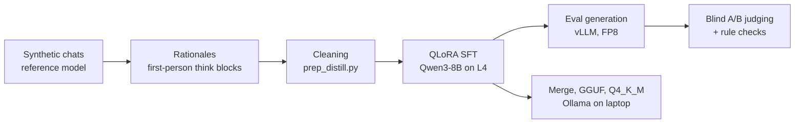

# Archon

**Distilling a "theorycrafting sparring partner" into Qwen3-8B with QLoRA, then judging it honestly.**

> This is a cleaned public snapshot of a private working repo. Development history, datasets and
> model weights are not included.

Archon is a personal, non-commercial learning project. The goal was a small local model that
cross-checks system design, ML and engineering plans: it pushes back when something is wrong,
sanity-checks the numbers and ends with a clear recommendation, in short conversational replies.
I took it end to end on a small budget: synthetic data, QLoRA training on one cloud GPU, a blind
evaluation against the base model, and a quantized build that runs locally in Ollama.

**The headline result is negative, and that is the interesting part.** The fine-tune learned the
target style almost perfectly but made more factual and arithmetic mistakes than the base model,
so base Qwen3-8B won the blind comparison in both training runs. The write-up below explains why.

## At a glance

| | |
|---|---|
| **Student model** | Qwen3-8B, QLoRA rank 32 (Unsloth + PEFT), 4-bit base |
| **Data** | ~3,950 synthetic multi-turn chats from a strong reference model (3,758 train / 203 eval) |
| **Compute** | One NVIDIA L4 (24 GB) on GCP, about 6.3 hours for 2 epochs |
| **Eval** | Blind pairwise A/B against base Qwen3-8B on held-out chats, plus rule checks |
| **Deployment** | Adapter merged shard by shard on CPU, GGUF + Q4_K_M via llama.cpp, served in Ollama at about 42 tok/s in ~6 GB of VRAM |
| **Outcome** | Style transferred, substance did not. Base model won both runs. |

## Pipeline



## Results

| Run | What changed | Fine-tune wins | Base wins | Ties |
|---|---|---|---|---|
| Run 1 | Answers only, no thinking | 44 | 113 | 0 |
| Run 2 | Added `<think>` rationales, stricter cleaning | 38 | 125 | 23 |

Run 1 was judged on 157 held-out chats and run 2 on 186. Run 2 did not improve on run 1.

The fine-tune matched the reference shape on every rule check: no markdown headers, almost never
over 250 words, a "My pick:" verdict and a follow-up question, and thinking under 710 tokens
(base used up to 2,652). But in run 2 it was tagged for wrong facts 151 times against 90 for base,
wrong arithmetic 69 against 31, and incoherent reasoning 67 against 9. It also invents specific
flags, APIs and hardware specs. Base loses points for generic checklists, headers and agreeing too
easily, but it is wrong less often.

- Full write-up: [`results/run2/judge/summary.md`](results/run2/judge/summary.md)
- Example answers side by side: [`results/run2/examples.md`](results/run2/examples.md)
- Training loss: eval loss went from **1.64 to 1.51** ([`results/run2/log_history.json`](results/run2/log_history.json))

## What I learned

- **SFT on another model's text copies the format, not the reasoning.** A lower eval loss and a
  perfect style match did not mean better answers. The model learned to sound confident in the
  right shape, including when it was wrong.
- **Evaluate blind, and check the judge.** Pairs were shuffled with sides randomized and the key
  kept aside until every verdict was in. A 30-pair re-judge with sides swapped found no position
  flips.
- **Data cleaning has to respect conversation structure.** Later turns build on earlier replies,
  so a chat is cut at its first bad reply rather than dropping single turns.
- **Getting a fine-tune onto consumer hardware is its own project.** Ollama would not load the
  LoRA directly, so I merged it shard by shard on the CPU to stay within RAM, then converted and
  quantized it with llama.cpp.
- **Next step:** logit-level distillation from a teacher that shares the tokenizer, or on-policy
  distillation, where the student generates and a stronger model scores or corrects its outputs.

## How it works

**Data.** About 3,950 synthetic multi-turn chats in which a strong reference model plays the
partner: it reviews a user's plan, checks the numbers and gives a verdict. For run 2, each
reference answer was given a first-person rationale written by a Qwen 32B model, explaining how
one would arrive at that answer. The rationale becomes the `<think>` block, so the student learns
to reason before it answers:

```
<think>
{rationale}
</think>

{answer}
```

**Cleaning.** [`train/prep_distill.py`](train/prep_distill.py) cuts each chat before the first
reply whose rationale rejects it, flags a flaw in the answer, is cut off or near-empty, or
contains stray tags or CJK text. Everything after a bad reply is dropped too. That left
**3,366 training chats** (9,134 assistant turns) and 186 held-out eval chats.

**Training.** [`train/sft.py`](train/sft.py) runs QLoRA rank 32 on
`unsloth/Qwen3-8B-unsloth-bnb-4bit` with thinking on. Each assistant turn is its own sample, with
loss on that reply only, because Qwen3's template keeps the think block only on the latest reply.
[`train/check_data.py`](train/check_data.py) verifies the template and loss masking with the real
tokenizer before training starts.

**Eval generation.** [`train/gen_vllm.py`](train/gen_vllm.py) uses vLLM with FP8 weights and
continuous batching. Base and fine-tune get the same prompts: one held-out assistant turn per eval
chat, picked with a fixed seed, with Qwen3's thinking-mode sampling.

**Judging.** [`eval/`](eval) builds blinded A/B packets, runs rule checks on both outputs and the
reference, and then unblinds.

## Data format

Training and eval files are chat JSONL, one chat per line. Every assistant reply is one `<think>`
block followed by the answer. This row is made up to show the shape; it is not from the dataset.

```json
{"messages": [
  {"role": "system", "content": "You are a sharp theorycrafting partner for system design, ML and engineering plans. Cross-check ideas, push back when something is wrong, sanity-check the numbers, and end with a clear recommendation. Keep replies short and conversational. No code unless asked."},
  {"role": "user", "content": "I want to log every API request to Postgres: about 2,000 requests/s at 1 KB each. One table, one index on timestamp. Fine?"},
  {"role": "assistant", "content": "<think>\nFirst check the volume: 2,000 x 1 KB is 2 MB/s, about 170 GB a day. Postgres can take the write rate, but the table grows fast and deleting old rows will hurt. Partitioning by day makes retention a cheap DROP. So the plan works with one change.\n</think>\n\nMostly yes, but that's about 170 GB a day, and deleting old rows from one big table will crawl. Partition by day so retention is a DROP TABLE instead of a DELETE.\n\nMy pick: daily partitions from day one. How long do you need to keep the logs?"}
]}
```

## Repository layout

| Path | What |
|---|---|
| `train/prep_distill.py` | Clean rationale data into `data/distill/{train,eval}.jsonl` |
| `train/sft.py` | QLoRA fine-tune (Unsloth + transformers Trainer) |
| `train/check_data.py` | Pre-flight check of chat template and loss masking |
| `train/gen_vllm.py` | Eval generation with vLLM (FP8) |
| `train/gen_eval.py` | Eval generation with Unsloth/transformers (slower fallback) |
| `eval/packets.py`, `eval/rules.py`, `eval/unblind.py` | Blinded pairwise judging and rule checks |
| `ollama/` | Shard-by-shard LoRA merge script and the Modelfile for Ollama |
| `results/run2/` | Loss history, adapter config, judge summary, example answers |

## Reproducing

You need your own chat data in the format above; the dataset is not published. Training and eval
generation need a CUDA GPU (an L4 with 24 GB was enough). On the GPU machine:

```
pip install unsloth vllm
python train/check_data.py          # run from a folder with data/train.jsonl and data/eval.jsonl
python train/sft.py --data data --out out
python train/gen_vllm.py --out out/gen_base.jsonl --max-new 4096
python train/gen_vllm.py --adapter out/adapter --out out/gen_ft.jsonl --max-new 2048
```

For judging, copy `gen_base.jsonl` and `gen_ft.jsonl` into `results/run2/`, then run
`python eval/rules.py` and `python eval/packets.py`, judge the packets, and run
`python eval/unblind.py`.

### Running locally in Ollama

The trained adapter is not published. To run your own adapter, merge it into the base model
first, since Ollama does not load the LoRA directly:

```
python ollama/merge_lora.py <Qwen3-8B-bf16-dir> out/adapter merged
python llama.cpp/convert_hf_to_gguf.py merged --outfile archon-think-f16.gguf
llama.cpp/llama-quantize archon-think-f16.gguf archon-think-q4_k_m.gguf Q4_K_M
ollama create archon:think -f ollama/Modelfile
ollama run archon:think
```

The Modelfile sets the training system prompt, a ChatML template that keeps the think block only
on the latest reply, and Qwen3's thinking-mode sampling. The Q4_K_M model runs fully on an 8 GB
laptop GPU.

## License

Code is Apache-2.0, see [LICENSE](LICENSE). No model weights or training data are distributed.
